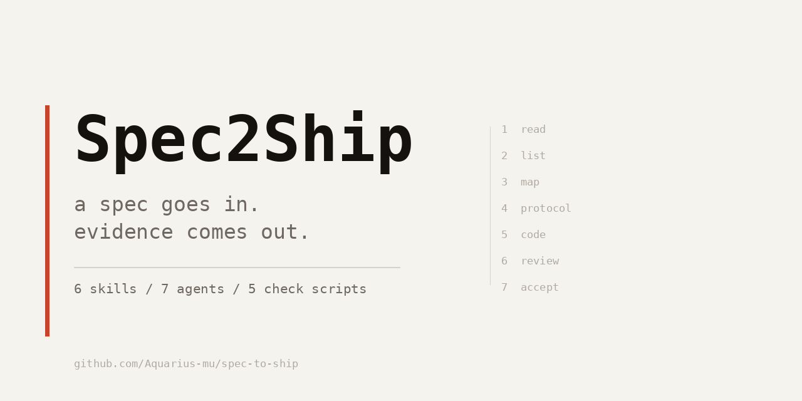

# Spec2Ship



把一份需求文档，变成能验收的代码。

给 Claude Code、Codex、Cursor 这类工具用的技能包。六个 skill、七个 agent、五个检查脚本，管同一件事：需求从文档走到上线，每一步都留下能查的证据。

```
读文档 → 列需求 → 对字段 → 定消息 → 写代码 → 审代码 → 实跑验收
```

每一步的产物是下一步的输入。少一步，脚本会报。

```bash
git clone https://github.com/Aquarius-mu/spec-to-ship.git
cd spec-to-ship && ./install.sh
```

装完打开项目说一句「帮我完成案子，文档链接是 xxx」就能跑。

中文为主。英文用户看 [English summary](#english)。

---

## 我为什么写这个

我做游戏服务端。让 AI 写一个函数，它写得挺好。让它落一整份活动案，它会稳定地漏掉几类东西：

- 需求里的内嵌表格和画板没读，字段按正文猜，猜错一半
- 消息定义只写了在线推送，玩家下线再上线，入口找不到了
- 扣费写了，退款没写
- 报告写「已实测通过」，实际只发了条消息、看到回包 OK

最后一类最要命。它自己说完成了，你信了，上线了，玩家看到一个空白页。

我一开始以为是模型不够聪明，于是把要求写得更细，写了几千字提示词。没用。同一次回答里，它可以先读规则再违反规则。

后来换了个思路：把规则变成它绕不过去的东西。每一步要有产物文件，下一步的脚本会检查上一个文件在不在、字段填没填。它想跳步，脚本报错。

这套东西就是这么攒出来的，前后改了很多遍。现在里面是一套七步流程、五个检查脚本、一个二十条的项目陷阱库。

## 它做什么

七步，顺序不能换。

| 步骤 | 产出 | 不做会怎样 |
|---|---|---|
| 读文档 | 载体清单：正文、内嵌表、画板、图片、评论、修订 | 漏掉评论区里那句「这个方案改了」 |
| 列需求 | `R-01` 到 `R-NN`，每条带出处 | 后面没法逐条验收，全靠记忆 |
| 对字段 | 文档字段 → 代码字段，缺一行都不许过 | 一个字段没接上，界面上就是空的 |
| 定消息 | CS/SC/Push 的定义和号段 | 写完代码才发现协议号撞了 |
| 写代码 | 按玩家动作走，每个写入点配一个撤销 | 扣了钱退不回来，发了奖重复发 |
| 审代码 | 六个独立 agent 分头看：安全、配对、逻辑、规范、可读性、需求符合 | 自己审自己，看不出自己漏了什么 |
| 验收 | 每条需求一个 `file:line` 加一条可复现证据 | 「跑过了」三个字，下次还得重跑一遍 |

小改动不用走全套。改一个数值、加一个字段，直接说就行，只有跨服、发奖、活动这类才会自动升到重档。

## 里面有什么

| 目录 | 干什么 | 什么时候你会点开它 |
|---|---|---|
| `skills/spec-to-ship` | 总入口，串起七步 | 拿到一整份案子 |
| `skills/spec-driven-dev` | 需求落到代码：字段映射、消息减法 | 已经有需求清单，开始写 |
| `skills/game-feature-playbook` | 开工前的六张表 | 动手前想清楚状态、上限、推送 |
| `skills/game-message-protocol` | 协议细则：号段、tag、CS/SC 契约 | 要加一条协议 |
| `skills/game-code-review` | 六路并行审查 | 代码写完，自己不敢信 |
| `skills/adversarial-gameplay-acceptance` | 模拟玩家实跑、四路取证 | 上线前想被人挑刺 |

`agents/` 下是那七个 agent，`skills/*/references/` 下是细则。`skills/spec-to-ship/references/codebase-pitfalls.md` 是我踩出来的二十条，比如：

> **拆文件后必须补 include。** 构建脚本把多个 `.cpp` 拼成一个编译单元，源文件靠拼接顺序蹭到别人的头文件。你把它拆出去，落到另一个单元，就报不完整类型。

> **「未使用」不等于「不需要」。** 字段读了不用、状态恒为某个值，八成不是冗余，是漏实现。删之前先分三类：真冗余、漏实现、旧存档兼容。

这两条都在真实项目里翻过车。

## 安装

需要 Python 3.8+。文档读取那部分依赖 `lark-cli`（飞书），用别的文档工具就换掉 `spec-driven-dev` 里的取文档命令。

```bash
git clone https://github.com/Aquarius-mu/spec-to-ship.git
cd spec-to-ship
./install.sh                  # 默认装到 ~/.claude
./install.sh ~/.config/agent  # 或指定你的工具目录
```

已存在同名目录会先备份再合并，不会整个覆盖。

装完验一遍：

```bash
python ~/.claude/skills/spec-to-ship/scripts/check_deps.py
```

十五项，缺哪个它直接说，不要跳过。

## 怎么用

第一次用要填一份项目画像，二十分钟左右，把代码根、编译命令、协议目录、日志路径、调试工具写上。之后每换一个仓库填一次。

```bash
cd ~/.claude/skills/spec-to-ship/references/profile
cp _template.md myproject.md
python ../../../scripts/check_profile.py myproject.md
```

`example-project.md` 是我编的一份范例，只演示该写多细。

然后就可以说话了：

| 你说 | 它做什么 |
|---|---|
| 帮我完成案子，链接是 xxx | 从读文档跑到交付表 |
| 按案子开发 | 只跑实现那一段 |
| 开工前要确认什么 | 出六张前置表 |
| 加一条 CS/SC | 走协议流程 |
| review 一下 | 六路审查 |
| 总体验收 | 模拟玩家实跑 |

实际跑起来大概是这样（示意）：

```
你   帮我完成案子，链接是 https://...
它   读完了。14 条需求，3 处需要你确认：
     1. 第 4 节写"每人一份奖励"，第 9 节的消息里只带了一份，按哪个？
     2. 活动结束后没有补发逻辑，参与但没领的怎么办？
     3. "战力前 10" 没写同分怎么排
你   1 按每人一份，2 走邮件补发，3 同分按报名时间
它   [写进已决台账] 继续。
```

## 三个流程脚本

提示词管不住的部分，交给脚本。

`check_progress.py` 查进度文件：需求编号连不连续、字段映射表里「缺」的行数是不是 0、覆盖表有没有漏项。

`verify_report.py` 查验收报告：说「实测」但没贴回包或日志，判失败；协议结论里没有推送，判失败；写了发现但没写 `file:line`，判失败。

`audit_message_contract.py` 双向对账：文档里有、IDL 里没有的叫幽灵项，反过来叫遗漏项。

它们只认形式，不认真假。内容对不对还是得人看。但至少「我跑过了」这句话，现在要有东西垫着。

## 换成你自己的项目

方法层不用改，项目层全在三个文件里：

| 文件 | 改什么 |
|---|---|
| `spec-to-ship/references/profile/<项目>.md` | 按模板填一份 |
| `spec-to-ship/references/codebase-pitfalls.md` | 换成你仓库的物理陷阱 |
| `adversarial-gameplay-acceptance/references/project-anchors-template.md` | 复制成 `project-anchors.md` 再填 |

迁移步骤写在 `references/bootstrap.md`。

## 它不做什么

- 不替你写产品需求。文档缺什么它会列缺口，不会编。
- 不保证没 bug。它保证每条需求都有验证证据，仅此而已。
- 没环境就只能读代码推断。它会标 `[推断]`，但推断就是推断。
- 包里没有任何凭据，token、地址、账号都要你自己配。

## 已知短板

- 中文写的，英文只有这份 README 的摘要。
- 强依赖飞书文档。换 Notion 或 Jira 要改一处取文档的命令，我没测过。
- 六个审查 agent 会误报。多的时候一半是误报，每条都得回源码核。
- 靶场部分要自己接，接不上就退化成案头审计。

## English

Spec2Ship is a skill pack for AI coding agents. It takes a product spec from "read it" to "every requirement has a file:line and a piece of evidence".

Six skills, seven agents, five check scripts. The scripts exist because prompts can't stop an agent from skipping steps; a missing output file can.

Built for game backends (state, protocol, cross-server, rewards) but the seven stages apply to any stateful backend. Read the tables above for the flow, install with `./install.sh`, then fill `references/profile/_template.md`.

用着顺手就点个 Star，能让更多被这四类问题坑过的人找到它。

## License

MIT。
